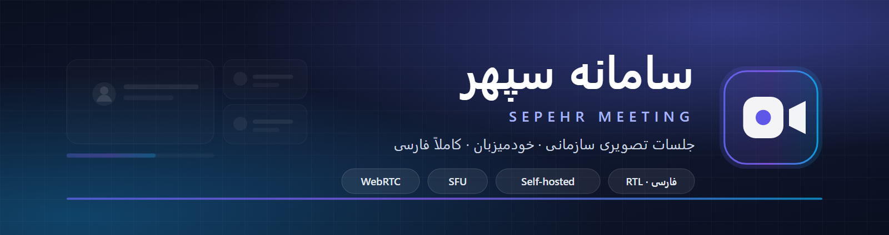
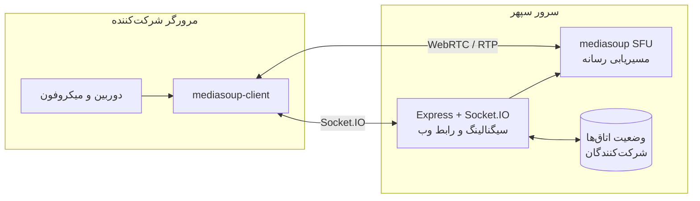

<div align="center">



# سامانه سپهر · Sepehr Meeting

**جلسات تصویری سازمانی، خودمیزبان و کاملاً فارسی**

[](https://nodejs.org/)
[](https://mediasoup.org/)
[](#شروع-سریع)
[](#رابط-کاربری)
[](LICENSE)

</div>

---

## سپهر چیست؟

سپهر یک بستر **ویدیوکنفرانس خودمیزبان** است که تمام جلسه‌ها را داخل سرور خودِ سازمان نگه می‌دارد؛ بدون حساب ابری، بدون ارسال داده به سرویس بیرونی و بدون نصب هیچ نرم‌افزاری روی سیستم کاربران.

- فقط با یک مرورگر کار می‌کند.
- رابط کاربری **فارسی و راست‌به‌چپ**، با تم روشن و انیمیشن‌های نرم.
- موتور رسانهٔ **mediasoup (SFU)**؛ بار پردازش روی سرور توزیع می‌شود، نه روی لپ‌تاپ شرکت‌کننده‌ها.
- رویدادهای زنده (چت، وضعیت میکروفون، دست بلندکردن، نظرسنجی) روی کانال داده انجام می‌شود.

## امکانات

| دسته | امکانات |
|---|---|
| 🎥 **تماس** | ویدیو و صدای چندنفره، انتخاب دستگاه ورودی، قطع/وصل میکروفون و دوربین، آینه‌کردن تصویر، تشخیص گوینده |
| 🖥️ **اشتراک** | اشتراک صفحه و پنجره/زبانه، اشتراک فایل، پخش ویدیو از یوتیوب، حالت تصویر در تصویر |
| 💬 **تعامل** | چت عمومی و خصوصی، پیام همراه فایل، نظرسنجی، تخته سفید، ویرایشگر مشارکتی، ایموجی، زیرنویس گفتار |
| 🛡️ **مدیریت** | نقش میزبان، اتاق انتظار (Lobby)، قفل اتاق، رمز عبور، اخراج شرکت‌کننده، مجوزهای دقیق میزبان |
| 👥 **اتاق‌ها** | اتاق‌های گروهی (Breakout)، دعوت با لینک/QR، ورود مهمان، لیست اتاق‌های فعال |
| ⚙️ **زیرساخت** | احراز هویت اختیاری OIDC، ضبط جلسه، REST API، اجرا در Docker، سرویس ویندوز |

## معماری



| پورت | پروتکل | کاربرد |
|---|---|---|
| `3010` | TCP | رابط وب و سیگنالینگ |
| `40000–40100` | TCP / UDP | جریان رسانه (mediasoup) |

## شروع سریع

**پیش‌نیاز:** Node.js **24.x** (تست‌شده روی 24.15.0) و npm 11.

```bash
git clone https://github.com/sepehrsdq/Sepehr-Meeting.git
cd Sepehr-Meeting
npm install

cp .env.template .env
cp app/src/config.template.js app/src/config.js

npm start
```

سپس در مرورگر باز کنید:

```
https://localhost:3010
```

> گواهی self-signed پروژه در `app/ssl/` است؛ بار اول پیام هشدار مرورگر را با
> **Advanced → Proceed to localhost** رد کنید.

<details>
<summary><b>اجرای سریع در ویندوز (بدون ترمینال)</b></summary>

روی `Start-Sepehr-Meeting.bat` دوبار کلیک کنید. این فایل سرور را بالا می‌آورد و مرورگر را باز می‌کند. راهنمای کامل: [`README-LOCAL-FA.md`](README-LOCAL-FA.md)

</details>

<details>
<summary><b>اجرا به‌صورت سرویس ویندوز</b></summary>

```powershell
node service.js
```

سرویس با نام `SepehrMeeting` ثبت می‌شود و بعد از بوت خودکار بالا می‌آید. جزئیات: [`DEPLOY-FA.md`](DEPLOY-FA.md)

</details>

<details>
<summary><b>اجرا با Docker</b></summary>

```bash
npm run docker:build
npm run docker:run
```

</details>

## تنظیمات

| فایل | کاربرد |
|---|---|
| `.env` | پورت، دامنه، رمزها، کلیدها و سرویس‌های جانبی |
| `app/src/config.js` | تنظیمات ظاهری و رفتاری (برند، منوها، امکانات) |

مهم‌ترین کلیدهای `.env`:

```env
SERVER_HOST_URL=https://localhost:3010   # آدرس عمومی سرور
SERVER_LISTEN_IP=0.0.0.0                 # شنود روی همهٔ اینترفیس‌ها
SERVER_LISTEN_PORT=3010                  # پورت وب
ANNOUNCED_IP=192.168.1.10                # IP سرور برای رسانه (شبکه داخلی)
UI_LANGUAGE=fa                           # زبان پیش‌فرض رابط
JWT_SECRET=تغییر-دهید                    # کلید امضای توکن‌ها
RECORDING_ENABLED=false                  # ضبط جلسه
```

> 🔒 فایل‌های `.env` و `app/src/config.js` در `.gitignore` هستند و نباید در مخزن قرار بگیرند.
> برای استقرار، از `.env.template` و `app/src/config.template.js` کپی بگیرید.

## شبکه و فایروال

برای استفاده در شبکهٔ داخلی، پورت‌های `3010` و `40000–40100` را باز کنید:

```powershell
New-NetFirewallRule -DisplayName "SepehrMeeting Web"      -Direction Inbound -Protocol TCP -LocalPort 3010        -Action Allow
New-NetFirewallRule -DisplayName "SepehrMeeting Media TCP" -Direction Inbound -Protocol TCP -LocalPort 40000-40100 -Action Allow
New-NetFirewallRule -DisplayName "SepehrMeeting Media UDP" -Direction Inbound -Protocol UDP -LocalPort 40000-40100 -Action Allow
```

سپس آدرس سرور را به کاربران بدهید: `https://<IP-سرور>:3010`

## رابط کاربری

| ویژگی | توضیح |
|---|---|
| زبان | فارسی کامل، چیدمان RTL منطقی (`dir="rtl"`, logical properties) |
| تم | روشن و آرام؛ **استیج تماس** روشن با کارت‌های سفید و سایهٔ نرم |
| استثنا | کاشی ویدیو، نام شرکت‌کننده و چیپ‌های روی تصویر عمداً تیره می‌مانند تا روی هر تصویری خوانا باشند |
| حرکت | انیمیشن‌های کوتاه و قابل‌قطع، سازگار با `prefers-reduced-motion` |
| دسترس‌پذیری | حالت فوکوس مشخص، کنتراست AA، ناوبری کامل با کیبورد |

## مستندات

| سند | موضوع |
|---|---|
| [`docs/self-hosting.md`](docs/self-hosting.md) | نصب روی سرور شخصی، Docker و تنظیمات محیط |
| [`docs/scalability.md`](docs/scalability.md) | چند worker برای یک اتاق و کلاستر چندسروری با Redis |
| [`docs/ngrok.md`](docs/ngrok.md) | انتشار موقت سامانه با تونل Ngrok |
| [`DEPLOY-FA.md`](DEPLOY-FA.md) | اجرای دائمی به‌صورت سرویس ویندوز |
| [`README-LOCAL-FA.md`](README-LOCAL-FA.md) | راه‌اندازی سریع روی ویندوز |

## ساختار پروژه

```text
app/            سرور (Express + Socket.IO + mediasoup)
  api/          نمونه‌های REST API
  src/          پیکربندی، مسیرها، احراز هویت، ضبط
public/         رابط کاربری
  views/        صفحات (landing, newroom, Room, login …)
  css/          تم و کامپوننت‌ها (توکن‌محور)
  js/           Room, RoomClient, I18n و …
  lang/         ترجمه‌ها (fa, en, …)
docs/           تصاویر و مستندات
tests/          تست‌ها
```

## عیب‌یابی

| مشکل | راه‌حل |
|---|---|
| `EADDRINUSE` | پورت ۳۰۱۰ اشغال است: `netstat -ano \| findstr :3010` و پروسهٔ قبلی را ببندید |
| دوربین/میکروفون کار نمی‌کند | دسترسی مرورگر را Allow کنید؛ فقط `https` یا `localhost` اجازهٔ رسانه دارد |
| صفحه سفید | `Ctrl+Shift+R` و بررسی کنسول (F12) |
| صدای قطع‌وصل | پورت‌های UDP `40000–40100` و مقدار `ANNOUNCED_IP` را بررسی کنید |
| دو نفر با یک نام | نام نمایشی دیگری انتخاب شود |

## مجوز

این پروژه نرم‌افزار **اختصاصی** است؛ همهٔ حقوق محفوظ است. استفاده، بازتوزیع یا انتشار مجدد فقط با اجازهٔ کتبی مالک مجاز است. جزئیات در [`LICENSE`](LICENSE).

<div align="center">

---

ساخته‌شده با ❤️ برای جلسات امن و فارسی

**© ۲۰۲۶ سپهر صدیق — Sepehr Seddiq**

</div>
