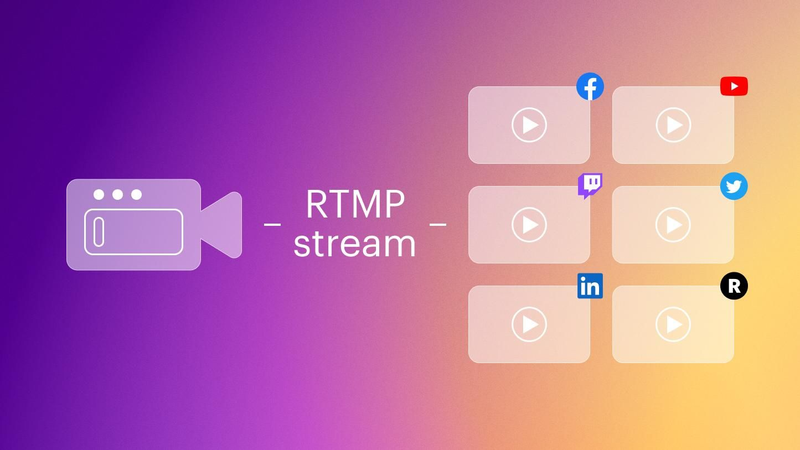

# پخش RTMP

پخش زندهٔ جلسه روی یوتیوب، فیسبوک یا هر سرور RTMP دیگر.



## راه‌اندازی

```bash
npm run rtmp:start     # nginx-rtmp با Docker
npm run rtmp:stop
npm run rtmp:logs

npm run nms:start      # Node Media Server با Docker
npm run nms:stop
npm run nms:logs
```

برای اجرای Node Media Server بدون Docker:

```bash
npm run nms:node:start
```

## تنظیمات

کلیدهای مرتبط در `.env`:

```dotenv
RTMP_ENABLED=true
RTMP_SERVER=rtmp://localhost:1935
RTMP_APP_NAME=live
RTMP_FROM_FILE=true       # پخش از فایل محلی
RTMP_FROM_URL=true        # پخش از URL
RTMP_FROM_STREAM=true     # پخش دوربین/میکروفون/صفحه
RTMP_MAX_STREAMS=1
RTMP_SECRET=sepehrRtmpSecret   # باید با config سرور RTMP یکی باشد
```

## ساختار پوشه

| مسیر | کاربرد |
|---|---|
| `nginx-rtmp/` | کانتینر nginx با ماژول RTMP |
| `node-media-server/` | کانتینر Node Media Server و API امضای استریم |
| `demo/` | نمونهٔ کلاینت و سرور برای تست پخش |
